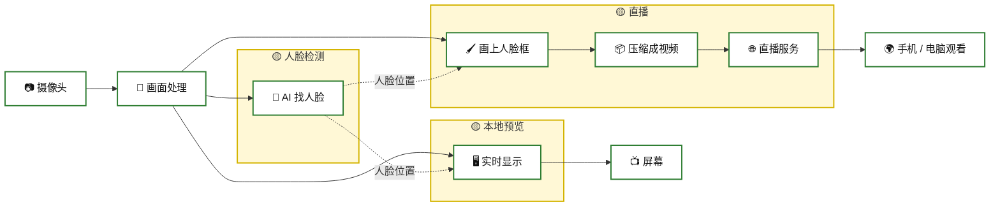

# smart_ipc —— 一条命令，把设备变成一台网络摄像机

smart_ipc 是一个开箱即用的网络摄像机程序。装好摄像头、给设备上电，敲一条命令，
它就把「本地看画面」「远程看直播」「自动识别人脸」这三件事一起做好了，
不需要再配别的软件，也不需要写一行代码。

## 它能做什么

| | |
|---|---|
| 🖥️ **本地实时预览** | 接上屏幕就能看到摄像头画面，自动适配屏幕尺寸和方向，横屏竖屏都行 |
| 🌐 **远程观看** | 手机、电脑、监控平台都能连进来看，支持播放器常用的 RTSP，也支持浏览器直接打开的网页直播 |
| 🧠 **AI 人脸检测** | 自动把画面里的人脸框出来，屏幕上和直播画面里都能看到，远端不用再装分析软件 |
| ⚡ **全程硬件处理** | 画面压缩、画框这些重活都交给芯片里的专用硬件做，CPU 基本不参与，设备不发烫、画面也不容易卡 |
| 🔧 **想要什么留什么** | 只要直播不要屏幕、只要画面不要直播、不想要人脸框……都是加一个参数的事 |

## 开箱默认是什么样

```sh
smart_ipc
```

就这么一句，什么参数都不用加，你会同时得到三样东西：

* **屏幕上看得到实时画面**
* **手机或电脑能连进来看直播** —— 地址是 `rtsp://设备IP:8554/live`
* **画面里的人脸被自动框出来** —— 屏幕上有，直播画面里也有

具体的默认规格：

| | |
|---|---|
| 直播画面 | 1280x720（720P），H.264 格式，约 1.5 Mbps |
| 观看地址 | `rtsp://设备IP:8554/live` |
| 屏幕预览 | 全屏，按屏幕实际尺寸和方向自动摆正 |
| 人脸检测 | 开着，屏幕和直播画面里都画框 |

想停就按 Ctrl-C。想改哪一项，翻到后面的「参数一览」。

---

## 画面是怎么走的



摄像头拍到的画面会**同时**分给三条路用：一条压缩后推给远端观看，一条直接显示在屏幕上，
还有一条交给 AI 找人脸。三条路各走各的，互不拖累——屏幕上偶尔卡一下，直播不会受影响；
AI 算得慢，也只是人脸框跟得慢半拍而已。

---

## 怎么看直播

程序跑起来后，在**同一个局域网**的电脑上：

```sh
ffplay rtsp://设备IP:8554/live
```

用 VLC、PotPlayer 这类播放器也行，把上面这个地址填进去就能看。

如果想**直接用浏览器看**，不想装播放器，就这样启动：

```sh
smart_ipc --stream webrtc
```

然后浏览器打开 `http://设备IP:8080/`。

---

## 常用命令

```sh
smart_ipc                                               # 什么都要，一直跑着

smart_ipc --stream webrtc                               # 改成用浏览器看
smart_ipc --codec h265 --bitrate 800000                 # 换 H.265，同样清晰但省一半流量
smart_ipc --width 1920 --height 1080 --bitrate 4000000  # 直播画面提到 1080p

smart_ipc --no-ai-burn                                  # 直播画面里不要人脸框（屏幕上还留着）
smart_ipc --no-display                                  # 不用屏幕，只做直播
smart_ipc --no-stream                                   # 不做直播，只当取景器看画面
smart_ipc --no-ai                                       # 不找人脸

smart_ipc --time 60                                     # 跑满 60 秒自动退出
```

---

## 参数一览

每个参数都有长短两种写法，效果一样，比如 `--no-ai` 和 `-a` 是同一个意思。

### 关掉不需要的功能

功能默认全都是开着的，下面这几个参数用来把你不需要的那部分关掉。

| 短 | 长 | 作用 |
|---|---|---|
| `-d` | `--no-display` | 不往屏幕上显示画面 |
| `-s` | `--no-stream` | 不做直播 |
| `-a` | `--no-ai` | 不找人脸 |
| `-e` | `--no-ai-burn` | 人脸框只留在屏幕上，不画进直播画面 |

> `--no-display` 和 `--no-stream` 不能一起用——两个都关掉，画面就没地方去了。

### 直播画质

下面这几个只影响**直播画面**。屏幕上的预览画面始终按屏幕自身的尺寸显示，不受这里影响。

| 短 | 长 | 这是什么 | 怎么填 | 默认 |
|---|---|---|---|---|
| `-c` | `--codec` | 用哪种格式压缩画面。H.265 一样清晰但流量少一半，不过有些老设备和浏览器放不了 | `h264` 或 `h265` | `h264` |
| `-W` | `--width` | 直播画面有多宽 | 像素数 | `1280` |
| `-H` | `--height` | 直播画面有多高 | 像素数 | `720` |
| `-f` | `--fps` | 告诉程序每秒大概有多少帧画面。**这个数填得比实际高，画质会打折扣** | 帧率 | `30` |
| `-b` | `--bitrate` | 每秒用多少数据量来存画面。给得越多画面越清晰，占的网络带宽也越大 | 多少 bit 每秒；填 `0` 让程序按分辨率自己算 | `1500000`（约 1.5 Mbps） |

### 人脸检测

| 短 | 长 | 这是什么 | 怎么填 | 默认 |
|---|---|---|---|---|
| `-x` | `--ai-width` | 拿多宽的画面去找人脸 | 像素数 | `1280` |
| `-y` | `--ai-height` | 拿多高的画面去找人脸 | 像素数 | `720` |
| `-k` | `--ai-model` | 用哪个人脸检测模型文件 | 文件路径 | `/usr/share/smart_ipc/face_detection_320.kmodel` |
| `-o` | `--ai-thresh` | 长得多像人脸才算数。调小了框会变多，但也更容易把不是脸的东西框进来 | 0 ~ 1 之间的小数 | `0.6` |
| `-n` | `--ai-nms` | 同一张脸上重叠的框合并得有多狠。调大了一张脸可能冒出好几个框 | 0 ~ 1 之间的小数 | `0.2` |

### 直播方式

| 短 | 长 | 这是什么 | 怎么填 | 默认 |
|---|---|---|---|---|
| `-m` | `--stream` | 用哪种方式直播。`rtsp` 给播放器看，`webrtc` 给浏览器看 | `rtsp` 或 `webrtc` | `rtsp` |
| `-p` | `--port` | 别人从哪个端口连进来 | 端口号 | RTSP 是 `8554`，WebRTC 是 `8080` |
| `-u` | `--path` | 观看地址最后那一段，也就是 `rtsp://设备IP:8554/` 后面跟的名字 | 一个名字，只对 RTSP 有效 | `live` |

### 其它

| 短 | 长 | 这是什么 | 怎么填 | 默认 |
|---|---|---|---|---|
| `-t` | `--time` | 跑多久自动退出 | 秒数；填 `0` 就一直跑 | `0` |
| `-h` | `--help` | 看一下都有哪些参数，看完就退出 | — | — |
